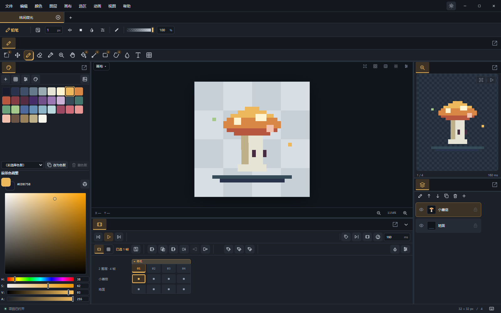
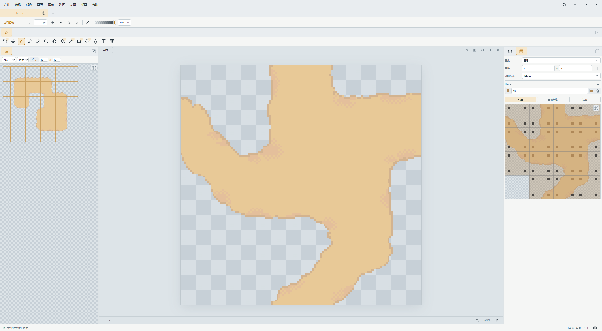
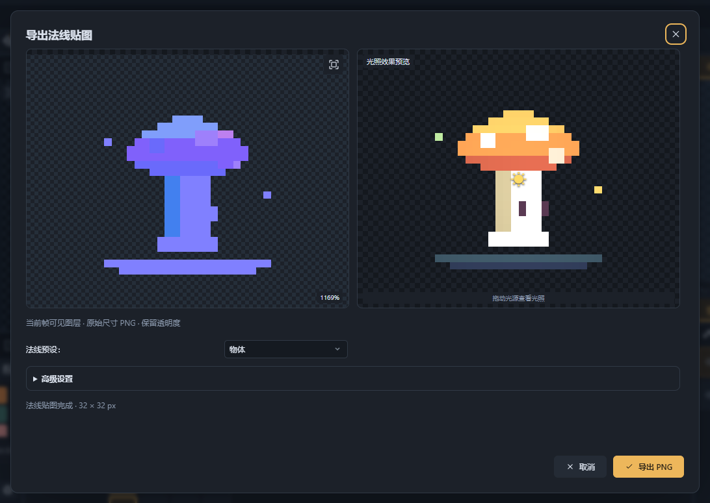
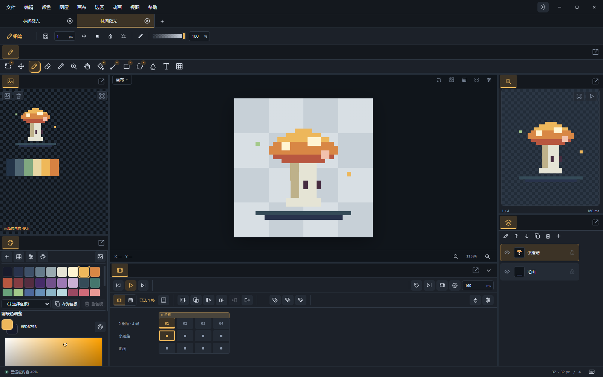

# MinePix

面向像素画、逐帧动画和游戏素材制作的 Windows 桌面编辑器。从参考图、绘画与动画，到地形拼接预览、法线贴图及引擎素材导出，在一个工作区里完成。

[English](README_EN.md) · [使用指南](docs/USER_GUIDE.md)

**免费开源 · Windows x64 · 中文 / English · 正式版 2.0.0**

[下载 Windows x64 安装包](https://github.com/Spicyfish95/minepix/releases/download/minepix-v2.0.0/MinePix.Tauri_2.0.0_x64-setup.exe)



*以“林间微光”示例展示绘画与动画工作区：色板、图层、预览和时间轴同时可见。以下截图均采集自 alpha.4 桌面版。*

## MinePix 特色

### 约 1.99 MiB 的安装包

使用 Tauri 2、Rust 和系统 WebView2；文件操作、项目存储及格式编解码由 Rust 处理。2.0.0 正式版 Windows x64 安装包为 **2,083,311 字节（约 1.99 MiB）**，不含共享 WebView2 Runtime，也不等于安装后占用；安装器另有更新缓存。

### 画图块时就检查地形拼接

在图集面板设置图块自身地形及相邻地形规则，再到地形预览中检查连接效果。支持按像素自动标注，适合边绘制边检查边角与接缝。预览用于验证素材，不参与作品合成与导出。



*将 dirt.ase 按 32×32 切块，使用“匹配角”自动标注，再在左侧绘制地形检查拼接。可打开[泥土匹配角示例](examples/dirt-corners.pix)体验。*

### 从像素画交付到游戏素材

除了单图、动画和精灵表，还提供 **Phaser 3 图集与动画**、**Godot 4 SpriteFrames** 导出预设。可配置裁边、打包及边缘扩展；法线贴图导出提供物体、角色、建筑、地形预设和光照预览，便于检查素材在光照下的表现。



*先对照法线与光照效果，再导出保留透明度的 PNG。[使用指南](docs/USER_GUIDE.md#导出游戏素材)还展示了引擎图集导出设置。*

### 参考板随作品保存

导入多张参考图，移动、等比缩放、取色并调整叠放顺序。参考图保存在 PIX 项目中，不混入最终导出的画面；下次打开作品即可继续对照绘制。



*角色设定和配色样张留在画布旁，导出时只包含作品。可打开[参考板示例](examples/reference-board.pix)体验。*

### 保留可编辑项目，按用途交付

分块压缩的二进制 **PIX** 保存图层、帧、色板及参考图等编辑信息；使用 **ASE / Aseprite** 与其他编辑器交换作品，再按用途输出 PNG、GIF、WebP、PNG 序列或引擎图集。保存主项目和导出素材各有清晰入口。

## 绘画与动画工具

| 工作内容 | 工具 |
| --- | --- |
| 像素绘画 | 铅笔、橡皮、填充、形状、对称绘画、图案笔刷 |
| 选区与调整 | 矩形、椭圆、套索、魔棒，缩放旋转，颜色调整与描边 |
| 图层与颜色 | 图层组、混合模式、RGBA、灰度与真实索引色、色板编辑 |
| 逐帧动画 | 帧时长、标签、洋葱皮、链接 cel、cel 范围编辑 |
| 工作区 | 可调整面板布局、多窗口、快捷键配置、项目恢复 |

## 安装与使用

下载上方安装包，以当前用户安装。安装器支持英语、简体中文及繁体中文；编辑器界面支持中文和英语。运行依赖 WebView2 Runtime，缺失时安装器会引导安装。文件默认打开方式由 Windows 管理，可通过“打开方式”选择 MinePix。

1. 按 `Ctrl+N` 新建画布，按 `B` 使用铅笔绘画。
2. 按 `Ctrl+S` 保存为 `.pix`，继续编辑时打开此项目。
3. 在时间轴添加帧制作动画，通过“文件 → 导出”生成交付素材。

也可打开仓库中的[蘑菇示例](examples/mushroom.pix)。更多操作见[使用指南](docs/USER_GUIDE.md)。

## 软件更新

重要作品建议保留副本。自动检查更新默认关闭，可通过“帮助 → 检查更新”手动检查，或在“帮助 → 关于”启用启动时自动检查。下载完成后点击“重启并更新”，按提示处理未保存项目，再完成覆盖和重启。

手动下载请进入对应的 `minepix-v<版本>` Release，选择 `MinePix.Tauri_<版本>_x64-setup.exe`；`.sig` 由更新器使用，无需手动打开。`tauri-latest` 保存更新频道清单。

## 开发

需要 Node.js 24、Rust stable MSVC、C++ Build Tools 和 Windows SDK。

```powershell
npm ci
npm run desktop
```

普通 main 推送和 PR 不触发 Actions。仅推送 `minepix-v*` 标签时，工作流执行完整测试、构建签名安装包并发布更新；日常开发在本地运行相关测试。

- [使用指南](docs/USER_GUIDE.md)
- [开发与验证](docs/DEVELOPMENT.md)
- [构建、签名、发布与更新](docs/RELEASING.md)
- [二进制 PIX 格式](docs/PROJECT_FORMAT.md)
- [差分更新协议](docs/DIFFERENTIAL_UPDATES.md)
- [示例作品](examples/README.md)
- [第三方许可证](THIRD_PARTY_NOTICES.md)

欢迎通过仓库 Issues 提交重现步骤和最小样例。项目使用 [MIT License](LICENSE)，第三方组件许可单独列出。
