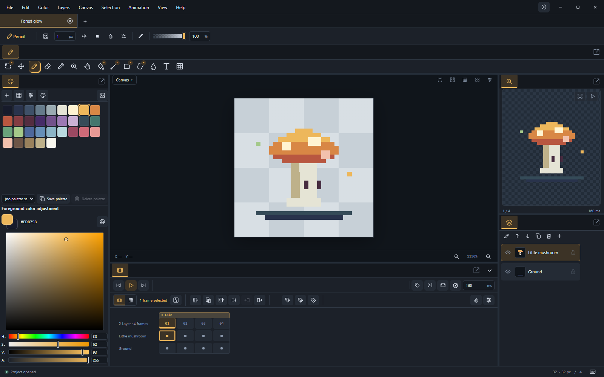
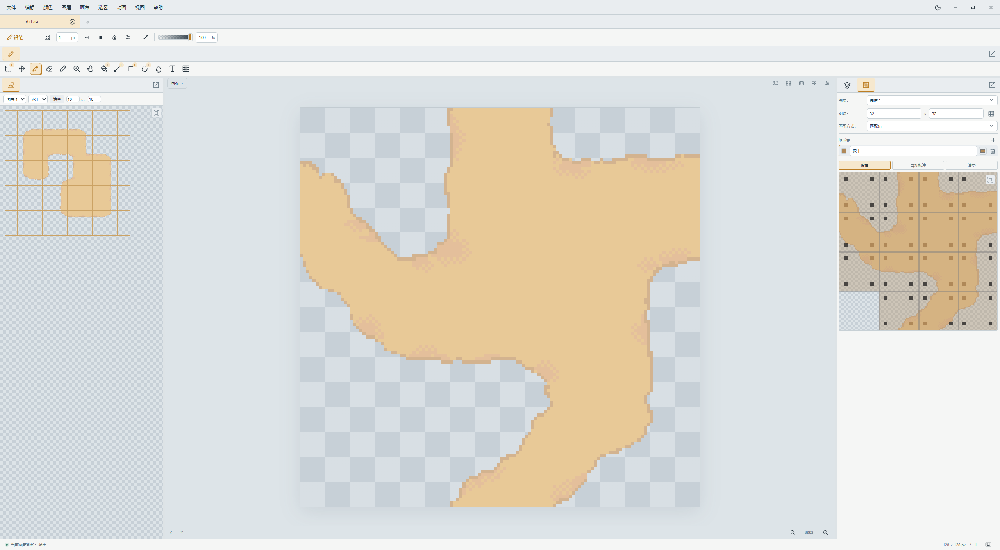
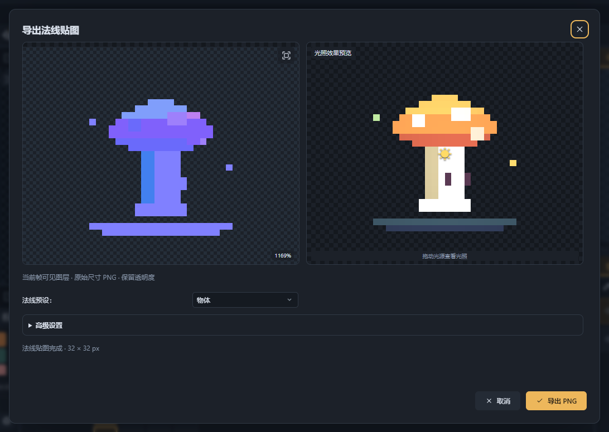
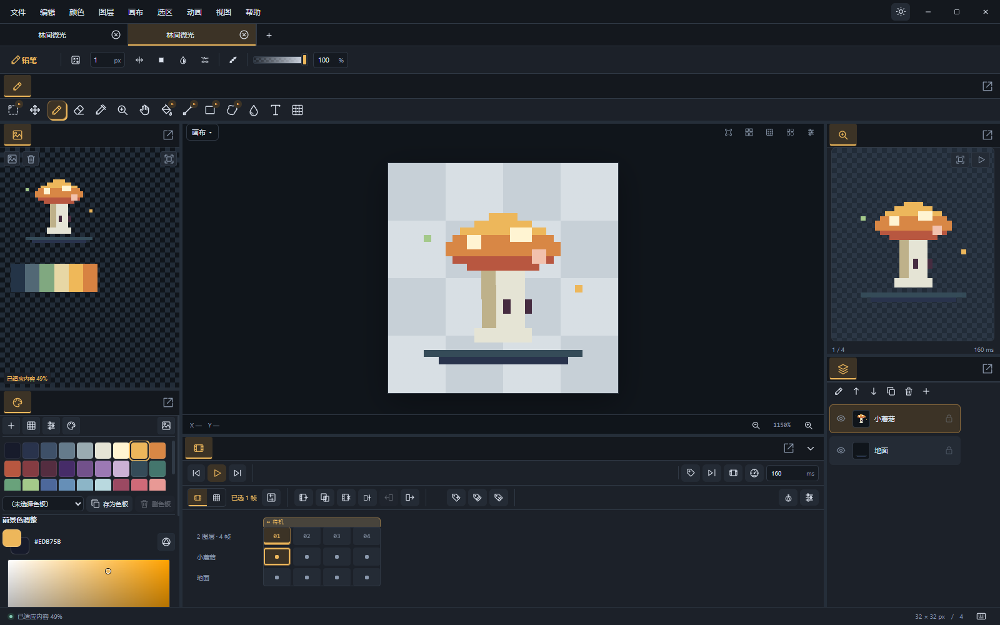

# MinePix

A Windows desktop editor for pixel art, frame-by-frame animation and game assets. Keep references, drawing, terrain connection previews, normal maps and engine exports in one workspace.

[简体中文](README.md) · [User guide (Chinese)](docs/USER_GUIDE.md)

**Free and open source · Windows x64 · Chinese / English · Stable 2.0.0**

[Download the Windows x64 installer](https://github.com/Spicyfish95/minepix/releases/download/minepix-v2.0.0/MinePix.Tauri_2.0.0_x64-setup.exe)



*The “Forest glow” example shows drawing and animation together. All screenshots were captured from the alpha.4 desktop app; the feature screenshots below use the Chinese interface.*

## MinePix highlights

### An installer of about 1.99 MiB

Built with Tauri 2, Rust and system WebView2, with Rust handling file operations, project storage and format codecs. The stable 2.0.0 Windows x64 installer is **2,083,311 bytes (about 1.99 MiB)**. This excludes the shared WebView2 Runtime and is not the installed footprint; the installer is also cached for updates.

### Check terrain connections as you draw tiles

Assign tile terrain and neighbor rules in the Tileset panel, then inspect connections in Terrain Preview. Pixel-based automatic annotation helps check corners and seams while creating assets. The preview is for checking assets and does not enter artwork composition or exports.



*Slice dirt.ase into 32×32 tiles, automatically annotate corner rules, then paint terrain in the preview to check connections. Try the [dirt corner-matching example](examples/dirt-corners.pix).*

### Deliver assets to game engines

Export images, animations and sprite sheets, with presets for **Phaser 3 atlases and animations** and **Godot 4 SpriteFrames**. Configure trimming, packing and edge extrusion. Normal map export includes object, character, architecture and terrain presets, with a lighting preview to inspect the result.



*Inspect the normals and lighting before exporting a PNG with transparency. The [user guide](docs/USER_GUIDE.md) also illustrates engine atlas export settings.*

### Save references with your artwork

Import multiple reference images, move and scale them, pick colors and change their stacking order. References are stored in the PIX project and stay out of exported artwork, ready for your next editing session.



*Keep character studies and palette samples beside the canvas without including them in exports. Try the [reference board example](examples/reference-board.pix).*

### Keep editable projects and export for each purpose

Compressed binary **PIX** projects retain layers, frames, palettes and references. Use **ASE / Aseprite** for exchange with other editors, and export PNG, GIF, WebP, PNG sequences or engine atlases for delivery.

## Drawing and animation tools

| Task | Tools |
| --- | --- |
| Pixel drawing | Pencil, eraser, fill, shapes, symmetry and pattern brushes |
| Selections and adjustments | Rectangle, ellipse, lasso, magic wand, scale and rotation, color adjustments and outlines |
| Layers and color | Groups, blend modes, RGBA, grayscale, true indexed color and palette editing |
| Animation | Frame durations, tags, onion skinning, linked cels and cel range editing |
| Workspace | Adjustable panels, multiple windows, configurable shortcuts and project recovery |

## Install and get started

Use the download above for a per-user installation. The installer offers English, Simplified Chinese and Traditional Chinese; the editor interface offers Chinese and English. WebView2 Runtime is required; follow the installer prompts if it is missing. Choose MinePix in Windows “Open with” to change a file's default application.

1. Press `Ctrl+N` to create a canvas, then `B` to draw with the pencil.
2. Press `Ctrl+S` to save a `.pix` project for further editing.
3. Add frames in the timeline and use File → Export to create delivery files.

You can also open the [mushroom example](examples/mushroom.pix). See the [user guide](docs/USER_GUIDE.md) for more workflows.

## Updates

Keep copies of important artwork. Automatic checks default to off. Use Help → Check for updates, or enable startup checks in Help → About. After downloading, choose Restart and update and follow the prompts for unsaved projects.

For manual downloads, choose `MinePix.Tauri_<version>_x64-setup.exe` from the matching `minepix-v<version>` release. The `.sig` file is used by the updater. The `tauri-latest` release hosts the update channel manifest.

## Development

Requires Node.js 24, stable Rust MSVC, Windows SDK and C++ Build Tools.

```powershell
npm ci
npm run desktop
```

Ordinary main pushes and pull requests do not trigger Actions. Only `minepix-v*` tag pushes run the full tests, build signed installers and publish updates. Run relevant tests locally during development.

- [User guide](docs/USER_GUIDE.md)
- [Development and verification](docs/DEVELOPMENT.md)
- [Build, signing, releases and updates](docs/RELEASING.md)
- [Binary PIX format](docs/PROJECT_FORMAT.md)
- [Differential update protocol](docs/DIFFERENTIAL_UPDATES.md)
- [Examples](examples/README.md)
- [Third-party licenses](THIRD_PARTY_NOTICES.md)

Operational guides are currently in Chinese. Report issues with reproduction steps and a minimal example. MinePix uses the [MIT License](LICENSE); third-party licenses are listed separately.
