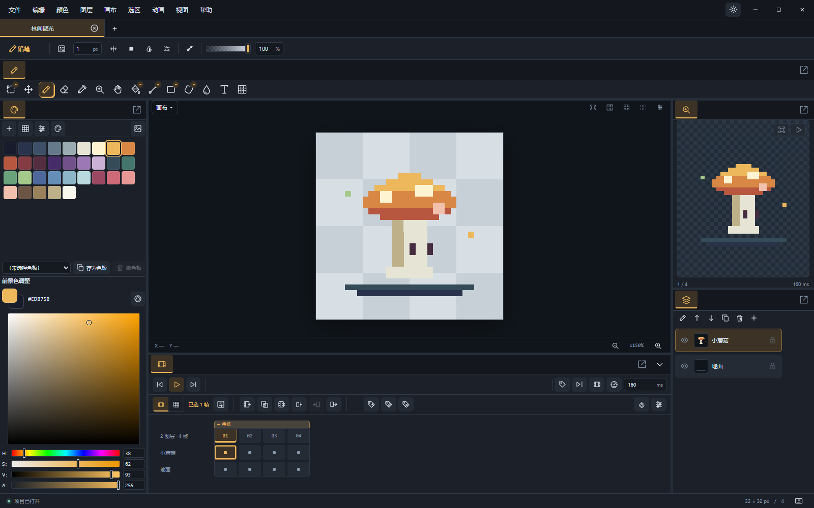
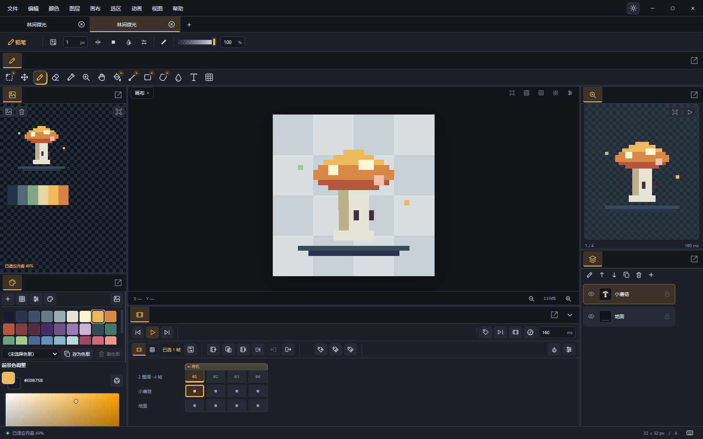
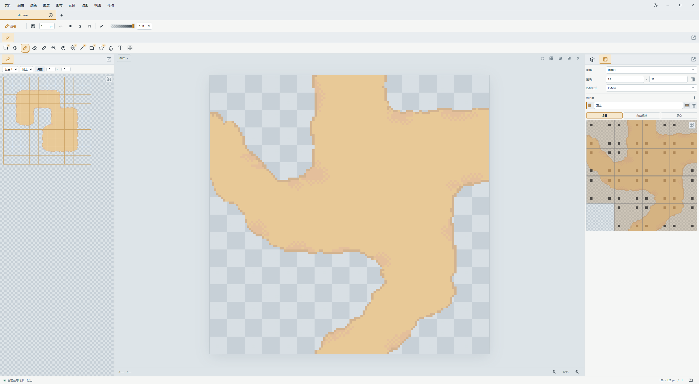
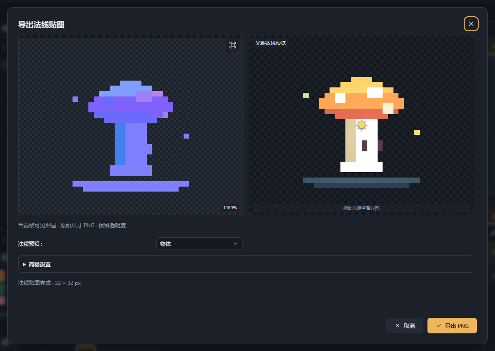
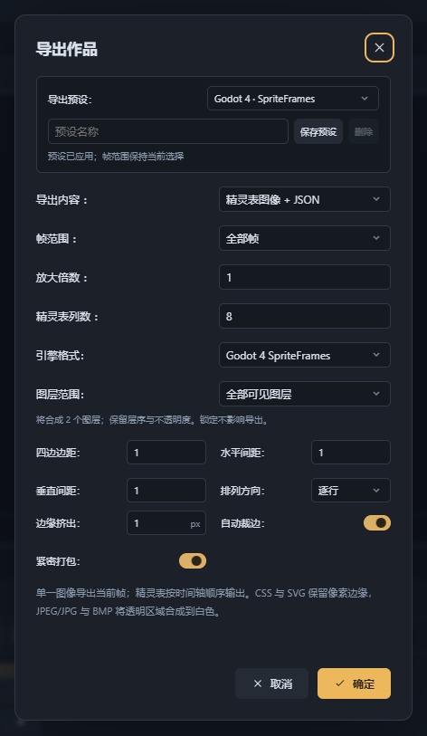

# 使用指南

从第一张像素画开始，再按需要使用动画、参考板、地形预览和游戏素材导出。快捷键以下述默认配置为准；可在“文件 → 设置”的快捷键配置中修改，或按 `F1` 查看当前快捷键。

本指南截图采集自 alpha.4 桌面版，使用中文界面，以深色主题为主；地形预览使用浅色主题和最大化窗口。面板可按自己的需要重新排列。

## Windows文件夹缩略图

Windows x64安装包会为当前用户安装独立缩略图扩展，让资源管理器中的`.pix`、`.ase`、`.aseprite`显示首帧可见图层合成预览，包含组、混合、透明度和16-bit索引色；参考板及外部参考图不参与。无需启动MinePix，也不修改作品或默认打开程序。

文件夹使用中／大图标等支持缩略图的视图，并允许Windows显示缩略图。安装或保存后Windows会按自身缓存策略刷新，必要时刷新文件夹。已安装的其他缩略图处理器（例如Aseprite自带扩展）保持优先，MinePix不会覆盖它。

缩略图是静态首帧，不是动画或完整预览窗格。独立扩展对输入、累计解压像素及元数据设64 MiB任务预算，输出最长边不超过1024像素；损坏、未知特性或预算超限时退回文件图标，不影响编辑器原有文件容量。ASE只解码首帧；PIX目前仍校验并解压全部数据块，但仅合成首帧。更新使用按版本存放的DLL，卸载仅清除自身注册；Windows占用中的旧DLL由卸载器尝试安排重启后清理。

## 安装与启动

在本仓库 Releases 的对应版本中下载 `MinePix_<版本>_x64-setup.exe`，支持 Windows x64；`.sig` 是更新器使用的签名文件，无需手动打开。选择英语、简体中文或繁体中文后，以当前用户安装。系统需要 WebView2 Runtime，缺失时按安装器提示完成安装。通过开始菜单或桌面入口启动。

安装界面的语言选项与编辑器语言分开；编辑器支持中文和英语。重要作品建议另存副本。

## 画第一张像素画

1. 通过“文件 → 新建”或 `Ctrl+N` 创建画布，例如 32 × 32。软件内已有复制像素时，宽高输入框默认使用复制区域的宽高（保留透明边缘及选区外接尺寸），仍可手动修改；没有复制像素时沿用软件设置。新项目保持空白，需要粘贴时再按 `Ctrl+V`。
2. 按 `B` 使用铅笔，在颜色面板选择前景色并绘画。`E` 切换橡皮，`G` 填充，`I` 吸管；按住 `Alt` 可临时取色。
3. 按住空格拖动以平移，滚轮缩放，`F` 适应画布，`1` 查看实际大小。`Z` 缩放工具左键放大、右键缩小；Alt 在缩放工具中也只临时取色，不再缩小。吸管工具或 Alt 临时取色时，按住鼠标拖动可持续更新颜色；透明像素与画布外不改变已取颜色。MinePix 在后台时，鼠标已经位于软件外也可直接按住 Alt 启动屏幕取色，光标显示吸管图标，单击采集颜色；也可从窗口内按住 Alt 移出。松开 Alt、按 Esc 或右键取消；取消后恢复原外部窗口焦点，Ctrl+Alt 等组合键不作为独立取色。屏幕取色不改剪贴板，颜色编辑开启且选中色槽时更新该色槽及引用它的索引像素，并沿用逐次撤销。
4. 按 `Ctrl+S` 保存为 `.pix`。`Ctrl+Z` 撤销，`Ctrl+Shift+Z` 或 `Ctrl+Y` 重做。
5. 通过“文件 → 导出 → 单一图像”选择 PNG 等输出格式。

可以先打开[蘑菇示例](../examples/mushroom.pix)体验编辑。保存 PIX 保留可编辑信息，导出图像用于分享和交付。

首页和“文件 → 最近文件”按所选项目的路径打开文件。文件被移走或删除时会提示打开失败，保留当前文档。

*中央画布用于编辑，右上预览便于观察整体效果；底部时间轴显示两层、四帧及“待机”标签。*

项目不再设置 32M 总像素上限，新建、帧层操作、参考图和导入导出不再按此阈值拒绝或自动缩小。实际可用尺寸取决于内存和目标格式；64 图层、256 帧、文件容量及独立渲染尺寸限制仍保留。

## 选区、图层与色板

初始内置色板为 **bright24**（24 色），色板库默认选中它。下拉列表先显示“我的色板”，再显示“内置色板”。删除用户色板时会显示名称并要求二次确认，取消则保留色板；确认删除不改变当前项目颜色。内置色板不可删除。“存为色板”保存命名色板；保存入库后，“设为预设”可把该色板作为后续启动和新建项目的默认值，已有项目保留自身色板。预设保存颜色快照，删除库中的原色板不会丢失预设。下拉列表中与预设内容相同的色板显示“（预设）”；当前色板已是预设、尚未保存入库，或内容已与库中条目不一致时，“设为预设”按钮置灰；保存入库后，若还不是当前预设，按钮才启用。撤销和重做同步更新状态。

色板下方不再显示“前景色调整”文字，通道模式、滑条和前景色调整操作保留。

前景／背景交换会同步索引绘画槽；灰度模式的新前景色按当前模式转灰，原前景色的Alpha保留在背景色中。

导入后，色板库下拉用完整文件名替换“（未选择色板）”临时项；点击“存为色板”时，名称默认使用导入文件名并去掉最后一个扩展名。例如导入 `coast.v2.pix`，默认保存名称为 `coast.v2`。切换项目、撤销和重做会恢复对应的导入名称；取消保存仍保留临时项，成功保存后选中库中的正式条目。

色板通过颜色操作菜单导入/导出。导出为二进制 `.pix` 色板，保留颜色顺序、重复色槽及 Alpha；“打开”、拖入或文件关联可识别色板 PIX 与项目 PIX。有项目时载入当前项目的色板，可撤销；无项目时创建空白项目承载色板。旧本机 JSON 色板库首次读取时自动迁移为二进制存储（WebView 设置内使用 Base64 承载）。

导入支持 `.pix`、Aseprite `.aseprite` / `.ase`（首帧新旧色板块）、Adobe `.ase`（RGB / CMYK / Gray）、`.gpl`、JASC / RIFF `.pal` 和 `.png`，保留原有 JSON 导入。PNG 按从左到右、从上到下的首次出现顺序提取全部颜色（含 Alpha）；Adobe Lab 色板暂不支持并显示错误。

索引项目导入色板时使用其中实际的全透明色槽；前65,536槽没有透明色时，在开头补透明槽，保留导入首色。切换较短的库色板时，能保留的槽继续按槽换色，超出范围的像素按原颜色匹配，透明像素保持透明；可撤销、重做，也可继续使用“重映射”。

按 `M` 激活选区工具，再次点击已激活的组合工具可选择矩形、椭圆、套索、多边形或魔棒。选中像素后，按 `Ctrl+T` 缩放或旋转；存在可编辑的可见选区时，`Ctrl+B` 可建立图案笔刷。图案笔刷按钮出现时紧靠笔形图标右侧；其气泡中的“存为笔刷”和“删除笔刷”并排显示，分别与左侧标签、右侧选择框的文字起点对齐。

图层面板用于管理可见性、锁定、透明度和分组；`Ctrl+Shift+N` 新建像素图层。把角色、背景或效果放在不同图层，便于分别调整。

在 A 项目按 `Ctrl+C` 复制当前图层的选区后，可切换到 B 项目按 `Ctrl+V` 粘贴；未选区时复制整个当前图层。新建尺寸使用复制区域的外接矩形宽高，椭圆、套索、带孔或分离选区的实际形状仍由掩码保留，选区外及完全透明像素不覆盖目标内容。跨项目粘贴优先使用目标选区左上角；无指定位置时，原坐标能完整容纳则保留，越界则移入目标画布，复制区域某一轴大于画布时，该轴从 0 开始裁切。粘贴可在目标项目撤销、重做，不改变源项目或剪贴板。

通过“颜色 → 颜色模式与量化”切换 RGBA、索引色或灰度。开启色板编辑时不自动选中色槽，也不显示选中高亮和操作按钮；主动选择后才显示，重新进入编辑会清空上次选择。索引色使用实际色板索引：开启色板编辑并选中色槽后，按住 Alt 从画布或参考图取色，会同时更新前景色和当前活动色槽；多选时只修改活动色槽。索引模式保留该槽的 index，并更新引用它的像素；色板修改可撤销、重做。编辑态拖动下方 HSV／RGB／Alpha 滑条或二维色阶时，色槽与索引像素实时变化，松开只记一步撤销；失焦取消本次调整。未开启编辑或未选中色槽时，取色只更新前景色。连续拖动取色时实时预览活动色槽，松开鼠标后整次操作记为一步历史；多次独立取色可逐次撤销、重做，同时还原前景色与活动色槽；取消或失焦会恢复本次拖动前的色板和前景色。通过“颜色 → 替换颜色”（`Shift+R`）可从色板选择源色与目标色；RGBA 模式也可手动输入颜色并设置容差，色板选色保留 Alpha。索引模式精确替换所选源 index 为目标 index，不修改色板，重复颜色色槽也按 index 区分；可选择当前 cel、当前层全部帧或整个精灵，并遵守现有选区。色板下拉的每个选项及选中项都以对应颜色为底色；弹窗靠右并保留画布可见，修改颜色、容差或范围时画布实时预览替换结果，取消恢复原状，点击确定才应用并记为一步撤销。排序、删除或新增色槽后，可使用“重映射”恢复最接近的原色。转换模式影响全部帧和像素图层，参考图保持原色。

## 制作逐帧动画

1. 在时间轴选择当前帧，按 `Shift+N` 新建空白帧，或按 `Shift+D` 复制帧。
2. 绘制动作，设置各帧时长；通过“视图 → 画布显示 → 洋葱皮”对照相邻帧。
3. 通过“动画 → 标签”把帧范围命名为待机、行走等动作，并配置播放方向。
4. 通过“动画 → 播放”或时间轴播放／暂停按钮预览，再导出 GIF、WebP、PNG 序列或精灵表。Space 仅用于按住临时平移画布，松开恢复原工具；轻按或长按均不切换播放状态。

cel 指某帧中某图层的图像单元。时间轴可对 cel 范围进行复制、移动、变换和链接。链接 cel 共享内容，修改会影响使用同一内容的帧；需要单独编辑时先通过“动画 → cel范围 → 取消链接”解除共享。

## 把参考图带进工作区

通过“视图 → 面板 → 参考”显示参考板，在面板中导入图片，也可将图片拖入参考板。拖动图片调整位置，拖动四角等比缩放，通过右键菜单调整层次或重置位置，并可从参考图取色。

PIX 只保存参考图源文件路径和位置、缩放等信息，打开项目时重新读取图片，不嵌入实际图片数据；参考图层导入的图片也采用相同方式。源图片修改后重新打开项目即可加载新版，即使图片尺寸不变也会刷新显示。它们不参与画布合成及导出；删除参考图不会删除作品像素。参考板修改也需要保存项目。源文件缺失时显示占位，双击参考图或右键“重新定位图片…”选择新位置。打开旧项目时，自动移除没有源文件路径的旧参考板条目，清空旧嵌入参考图层的数据，保留其他作品内容；有路径的新式参考图继续加载。清理先在内存中完成，保存后才写回项目，需要的旧参考图可重新导入。

参考图加载期间切换标签，图片仍加入发起导入的项目；原标签关闭后停止导入。保存期间产生的新修改继续显示为未保存，需要再次保存。

在其他软件复制图片，或在资源管理器复制一个或多个图片文件后，将鼠标移到参考栏目内按 `Ctrl+V`，图片会依次加入参考画布；已有文件保留源路径，剪贴板位图和截图须先保存为独立图片，取消保存则不添加。独立参考窗口也支持。支持 PNG、JPEG、WebP、GIF 和 BMP 文件。鼠标离开参考栏目时保持原有像素粘贴；输入框中的粘贴仍编辑文字。没有项目时，粘贴参考图会新建一个项目。

*左侧参考板中的图片独立于画布图层。导入本地图片后即可尝试移动、缩放和取色。*

## 截图并导入

软件处于前台时按 `Ctrl+1`，或选择“编辑 → 屏幕截图”。鼠标变为十字准星，旁边显示操作提示；初始不铺截图、不显示选区或工具栏。单击保持待选，双击直接截取当前显示器整屏并复制；拖动鼠标则框选区域，轻微手抖不会生成选区。快捷键可在设置中修改。

多显示器时只激活鼠标所在的一台，移动到另一台即切换。拖动期间及已有选区时固定当前显示器，鼠标越界不会切屏；选择“重新框选”清除选区，恢复随鼠标切换。选区显示实际像素尺寸，下方工具栏可选当前整屏、重新框选、取消或复制。已有选区时，在选区内双击或按 `Enter` 都会复制该选区；内外单击都保留范围，拖动可重新框选，选区外双击截取当前整屏。按 `Esc` 退出截图模式。

截图窗口预载并复用，进入模式无需等待整屏图片传输；选中后才显示冻结的截图。准备失败时会显示错误提示，可点击“关闭”返回编辑器后重试。

确认后图片进入系统剪贴板，截图遮罩和工具栏不会出现在结果中。没有打开项目时，会自动打开现有图片导入处理窗口；已有项目时保留当前作品，可将鼠标移到参考栏目按 `Ctrl+V` 加入参考画布。取消截图不会改动剪贴板。

## 检查图块与地形连接

此工作流用于检查图块规则与接缝，尤其适合绘制地形素材时反复验证边角。

1. 选择放有图块素材的像素图层，使用图层面板的“转为图集”按钮，设置图块宽高及切块帧。转换保留原图块的网格位置，全透明位置记为空格，并将所选帧的图集写回该图层所有帧；先保存副本再尝试。
2. 图集与地形预览只在当前项目存在图集图层时可添加或显示；无图集时右键添加入口不出现、视图菜单项禁用，删除最后一个图集图层或切换到无图集项目会隐藏这两个栏目。图集面板会随转换打开；通过“视图 → 面板”还可显示“地形预览”。在图集中选择图集图层，后续调整图块尺寸时点击“重新切块”使其生效。
3. 在地形集中添加地形，在“设置”模式下点击图块九宫格中心设置自身地形，点击四边或四角设置期望邻居地形，右键清除标注。
4. 已设置自身地形的图块可使用“自动标注”，按像素推断邻居规则，再人工检查结果。
5. 在地形预览中绘制地形，观察连接效果；有问题时回到图集修正规则或作品像素。

地形预览不会进入画布合成、普通图像导出或撤销历史。它不是完整关卡编辑器；Godot 的 SpriteFrames 导出也不等同于 TileSet 资源导出。预览输出最多 8M 像素、单边 8192，超限时按面板提示缩小预览。

*此处为[泥土匹配角示例](../examples/dirt-corners.pix)：从 dirt.ase 导入 128×128 素材，按 32×32 保留 4×4 排列，其中 15 块有像素、1 块透明。设置非空图块自身地形为“泥土”，选择“匹配角”后执行“自动标注”，左侧绘制的 50 格预览全部匹配。中央显示原图集，右侧可选择图块检查四角规则。*

## 生成法线贴图

通过“文件 → 导出 → 法线贴图”进入。输入为当前帧可见图层，输出为原始尺寸、保留透明度的 PNG。

先选择物体、角色、建筑或地形预设，查看法线与光照预览，再按需要调整形状强度、平滑、切面等高级设置。可自动估计原绘光照，或关闭自动估计后手动调整角度；需要 DirectX 方向时勾选“翻转 Y”。等待生成完成后选择“导出 PNG”。

这项功能根据二维图像估算法线，使用预览判断是否适合素材，不应将结果视为精确的三维几何信息。

*左侧检查法线分布，右侧拖动光源观察效果；图中使用“物体”预设。*

## 导出游戏素材

桌面普通、Aseprite 与法线贴图导出对话框均将“导出目录”输入框和“选择目录…”按钮放在同一行，输入框在前、按钮在后：项目首次导出默认其文件所在文件夹；未保存项目使用最近成功导出目录，没有记录时由系统选择器决定。设置有效目录后，点击确认直接写入该目录，不再弹出文件或文件夹选择器；单文件按作品名和所选格式生成文件名，同名文件直接覆盖。PNG 序列与配对图集仍在该目录下创建自动编号子文件夹。仅未设置目录时才弹系统选择器；无效目录会报错，不改存到其他位置。成功导出后，该项目沿用实际输出目录，取消或失败不更新记录。

“文件 → 导出 → 快捷导出”（默认 `Ctrl+E`）沿用当前项目上一次成功导出的格式、参数、帧范围及文件／文件夹路径，静默覆盖对应输出，不弹配置或路径窗口。支持单图、动画、精灵表／引擎图集、PNG 序列、元数据、ASE 和法线贴图。各项目独立记忆，已保存项目按路径在本机保留记录；从未成功导出的项目入口置灰。快捷键可在设置中修改。普通导出的全局预设不携带这些项目专属记录。

快捷导出使用当前作品内容和上次选定的源帧／图层；相关帧、图层、标签或目标目录不存在时显示错误，请重新普通导出。仅导出元数据时，已设置目录则直接关联其中的 `<作品名>-sheet.png` 并写入同名 JSON，不再询问路径；请先导出该精灵表 PNG。PNG 缺失或与当前输出设置的尺寸／像素不一致会报错，不覆盖已有 JSON。PNG 序列和配对图集快捷导出复用原目录，保留目录内无关文件，普通导出仍新建自动编号目录。导出不改变作品内容、撤销历史或保存状态。

通过“文件 → 导出 → 精灵表 / 引擎图集”选择导出预设。可调整裁边、打包、边距、间隔及边缘扩展，并保存自定义预设供后续使用。

*图中选择 Godot 4 SpriteFrames，边缘扩展为 1 px，并启用自动裁边和紧密打包。切换预设可使用 Phaser 3 导出方案。*

| 用途 | 导出选择与内容 |
| --- | --- |
| 通用精灵表 | 图像及原生 JSON 元数据 |
| Phaser 3 | 图集图像、图集 `.json`、`.animations.json` 及补充 `.pixpix.json` 元数据 |
| Godot 4 | 图集图像、SpriteFrames `.tres` 及补充 `.pixpix.json` 元数据 |
| 动画预览 | 在“GIF动画”入口的导出对话框中选择 GIF 或 WebP |
| 逐帧交付 | PNG 序列 |

引擎预设使用作品的帧时长与动画标签生成动画信息。将导出文件一起交付，保持相对路径；在引擎中检查纹理过滤、资源路径及播放效果。

## 选择保存与交换格式

桌面版按发起保存时的文档快照在后台打包、保存，期间可继续绘制或切换标签；首次保存／另存为仍需先在系统窗口确认路径。参考图仅传输路径和变换信息，不随项目打包图片。保存期间的新编辑不会混入此次文件，完成后仍显示未保存标记，需要再按 `Ctrl+S`；同一项目保存中重复按键不会启动并发写入。关闭文档／窗口会等待正在进行的保存，若又有新修改则保留确认；跨窗口移动文档需等保存结束。

| 格式 | 适合用途 | 注意事项 |
| --- | --- | --- |
| PIX | 继续编辑的主项目 | 二进制分块压缩，保存图层、帧、色板、参考图及作品元数据，不能当作文本 JSON 编辑 |
| ASE / Aseprite | 与其他编辑器交换 | 通过“文件 → 导入 / 导出”使用，阅读导入限制提示；仍保留 PIX 主项目 |
| PNG、GIF、WebP 等 | 分享、预览或交付素材 | 导出结果不保留完整的编辑信息 |
| 精灵表及引擎资源 | 游戏开发交付 | 图像与配套元数据一起使用 |

通过“文件 → 导入”还可使用 PNG 序列、序列清单和精灵表 JSON。不要通过修改扩展名进行格式转换。

## 工作区与恢复

拖动面板标签调整布局，也可使用独立窗口组织工作区。面板隐藏时从“视图 → 面板”重新打开；布局混乱时选择“视图 → 布局 → 恢复默认布局”。聚焦面板标签时，左右方向键切换标签；聚焦分隔条时，方向键调整尺寸。这些操作不会同时移动画布选区或切换动画帧。

自定义“网格选取（按住）”时，显式包含 `Shift` 的绑定必须按住 Shift；不含 Shift 的绑定允许叠加 Shift 约束，配置会检查这两种状态与其他动作的冲突。默认 `G` 始终切换填充工具，包括从选区工具切换；网格选取默认未绑定，可自行配置按住键。旧版默认网格 `G` 自动清除，其他自定义按住键保留。松开网格主键即可退出临时网格模式，与 Alt、Ctrl 或 Shift 的释放顺序无关。

参考、地形预览和预览栏目拆成独立窗口后，右上角 Pin 按钮可切换置顶；主题色高亮表示已置顶，再次点击取消。每个窗口独立控制，重新打开窗口默认不置顶。

表单中的说明文字只作说明：点击文字或标签空白，不会聚焦输入框、激活下拉框或切换 Switch。点击控件本体即可操作，也可用 `Tab` 切换焦点，用键盘输入、选择或按空格切换开关；弹窗和独立窗口使用相同规则。

通过“文件 → 保存 → 恢复项目”检查可用恢复记录。恢复内容位于应用自己的数据目录；关闭、放弃修改及保存操作遵循界面提示。恢复记录用于应对意外中断，重要作品仍需单独备份。

## 更新

1. 首次使用默认选中“启动时自动检查更新”，启动后发现新版本会自动下载。可在“帮助 → 关于”关闭，已有选择会保留；也可通过“帮助 → 检查更新”手动检查。
2. 下载时可查看进度、取消或重试。安装包通过固定公钥签名与版本验证后保存在应用数据目录；未安装就关闭软件，下次启动会离线重新验证并直接复用，不重复下载。
3. 点击右下角主题色更新图标（悬停提示“有可用更新”），或在更新面板选择“重启并更新”。按提示处理所有窗口中的未保存作品，再执行覆盖安装和自动重启；取消或安装失败会保留有效更新包。
4. 新版启动并确认更新已生效后，自动清除待安装包和元数据；安装器仍在退出的临时文件会在后台重试清理。不长期保留完整安装器副本，不删除用户自行保存的作品或下载的手动安装包。

下载完成的系统通知可返回正在运行的编辑器；退出应用后点击历史通知不保证能重新激活。也可从对应版本 Release 手动下载安装器。

安装器只注册可选的文件打开方式。需要修改默认关联时，请使用 Windows 的“打开方式”或默认应用设置。卸载应用不会删除用户保存的作品。

## 问题反馈

在仓库 Issues 描述应用版本、Windows / WebView2 版本、重现步骤及最小样例。不要在公开问题中包含私密作品、凭据或签名密钥。

开发与构建见[开发指南](DEVELOPMENT.md)，版本发布见[发布指南](RELEASING.md)，格式细节见[PIX 格式](PROJECT_FORMAT.md)。

同尺寸重新切块保留每个位置独立的地形、邻居位和权重，即使图块像素相同；改变尺寸后按内容迁移能够匹配的规则。检视器多选不同值时下拉留空，修改后统一应用到选中图块。

默认布局的下方栏目保持折叠，只显示标签条；点击时间轴标签或展开按钮后显示内容。手动折叠或展开状态保存在本机，重新启动及补回缺失栏目时保留，不随 PIX 文件单独切换。

PIX 项目使用长方形文档图标，软件使用独立的应用图标。首次安装只为尚未分配的 `.pix` 设置默认类型，保留用户已有的默认应用选择；覆盖安装刷新 MinePix 自身的文档图标及打开命令。

参考板图片不占用绘画／色板撤销条目的数据预算；索引色编辑中连续修改颜色，退出编辑后仍可逐次撤销和重做。

打开 `.ase`／`.aseprite` 后直接进入编辑，不再显示导入确认；未支持的扩展元数据提示显示在状态栏。普通 cel 保留源图尺寸、位置和索引，不再为多帧多层项目逐个补齐整张画布。像素通过二进制读取通道载入，读取期间显示“正在读取文件…”，失败时提示原因并恢复操作，保留当前项目。

有磁盘路径的ASE打开后处于已保存状态，顶部标签的黑点只在实际修改后显示，撤销回打开时的保存点会清除；无路径的导入仍标为未保存。扩展元数据告警不会单独触发未保存标记。

色板不再限制256项：ASE／PIX项目、色板导入导出、本机色板库、剪贴板与增删重排均保留完整色板，包括重复颜色和Alpha。索引模式使用16-bit索引（0–65535），可直接引用前65,536个色槽；更后的色槽仍保留，可在RGBA模式选色。PIX完整保存索引关系、透明槽和色板。

“添加前景色”按钮同样支持已有超过256项的色板，追加颜色可撤销和重做；不会改变已绘制像素的索引。

ASE格式仍只支持8-bit索引：全部像素及透明槽在0–255时保存为索引ASE；使用更高索引或透明槽时自动保存为RGBA，保留像素颜色、透明度和完整色板，但重开ASE无法恢复16-bit索引关系。导出弹窗和保存状态会说明转换；需要继续索引编辑请保留PIX。打开操作不会修改原文件。

“文件 → 设置 → 常规与显示 → 默认保存文件格式”可选 `.pix`、`.aseprite`、`.ase`、`.png`、`.webp`、`.jpg`、`.jpeg`、`.svg`、`.ico`、`.gif`，初始为 `.pix`。成功保存后默认值跟随最后一次实际保存的文件类型，取消或失败不改变默认值；已有文件直接保存沿用原路径及格式。ASE 使用真实 Aseprite 编码，保留该格式支持的内容；参考板、参考图层等 MinePix 专属信息请使用 PIX 保存。

选择 PNG／WebP／JPG／JPEG／SVG／ICO／GIF 保存格式时，只保存发起保存时当前帧的可见合成图像，不保存隐藏层或参考图，GIF 也是单帧静态图。选择路径期间切换帧或继续绘画，不会改变这次保存的快照。JPG／JPEG 的透明区域铺白，GIF 使用单比特透明度；ICO 单边最多 256 像素，超出时提示缩小后再保存。多帧、图层和项目专属信息请使用 PIX 保存。成功保存后记住实际文件类型，取消或失败不改变默认值。

恢复副本使用二进制像素快照，结构信息单独保存；参考图只记录路径，恢复时重新读取。连续编辑的恢复写入按顺序完成，取消或失败不会用未完成数据覆盖最近一份有效快照。旧文本恢复副本仍可读取。

图像、动画和 ASE 导出在桌面桥接中使用原始字节传输，导出格式、目标目录、同名覆盖及取消行为保持不变。

项目在主窗口与独立窗口间移动时，像素和撤销历史使用二进制传输，保留链接 cel 共享关系、选区及窗口视图；目标接收成功后才从源窗口移除。

索引色项目以索引和色板为准进行渲染，编辑所需颜色缓存按需生成；重复色槽身份、链接 cel 以及撤销重做保持。此优化不改变 PIX／ASE 文件格式，图像、动画和法线输出直接使用编码字节，减少临时文本和大数组拷贝。

最近文件预览会缓存并随文件修改刷新；欢迎页按可见项目加载，最近文件弹窗按所选项目加载。图层小图使用显示尺寸采样，不影响画布或导出分辨率。

自动恢复会合并同一项目尚未处理的中间版本，优先写入最新编辑状态；清理恢复副本会等待此前写入完成，避免旧任务重新生成已清理的副本。

大项目编辑会按操作范围记录撤销：图层名称、显隐及帧时长等调整无需复制全部像素，局部像素操作保留当前 cel 和链接帧的一致性。保存仍可在后台进行，保存期间的新编辑保留为未保存状态。

大项目后续优化：裁剪图像绘画、打开索引项目、多帧时间轴、参考图显示和取色减少了重复处理；小选区按选区范围计算，填充与魔棒保持四连通及平铺规则。关闭较早项目后会回收不再使用的参考画布，重新打开时按需生成；参考源重新定位后，显示和取色立即使用新图。缓存回收不修改源图片或项目文件。

索引ASE的打开进一步减少解码、校验和首次合成的重复处理。实际等待取决于文件内容、系统缓存和程序是否已启动；本地Debug版本不用于评估发行版打开速度。

索引色板重排后，裁剪图像范围外会继续使用当前透明槽；复制、翻转及其撤销重做保持透明边缘，不会因透明槽位置变化造成索引与颜色不一致。

单次大操作超过撤销内存预算时，操作仍会完成并标为未保存，状态栏提示“本次无法撤销”；请确认结果并及时保存。撤销预算不会因该操作自动增加。

使用“重开关闭文档”恢复先前选择“不保存”的内容时，这些恢复的改动会重新标为未保存，再次关闭会询问保存；已保存且无修改的文档重开仍保持干净。
