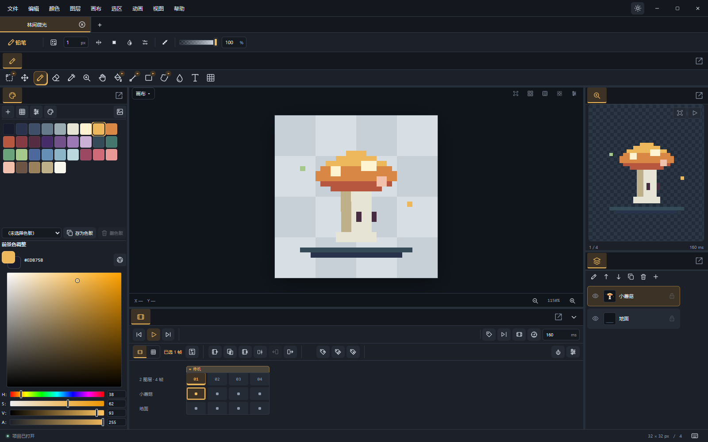
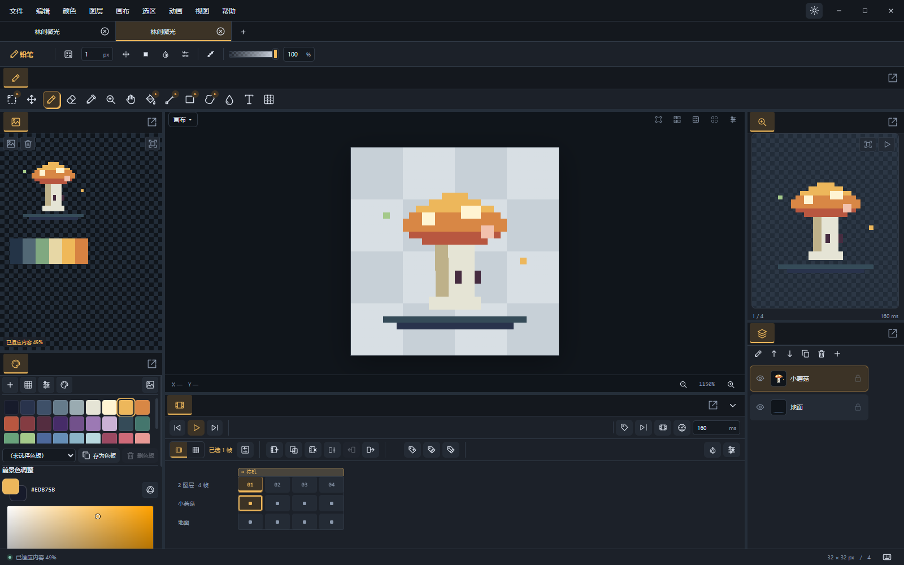
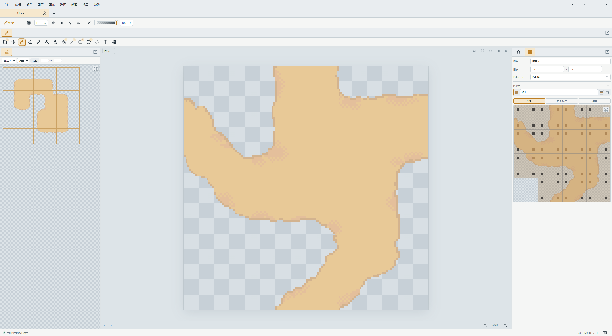
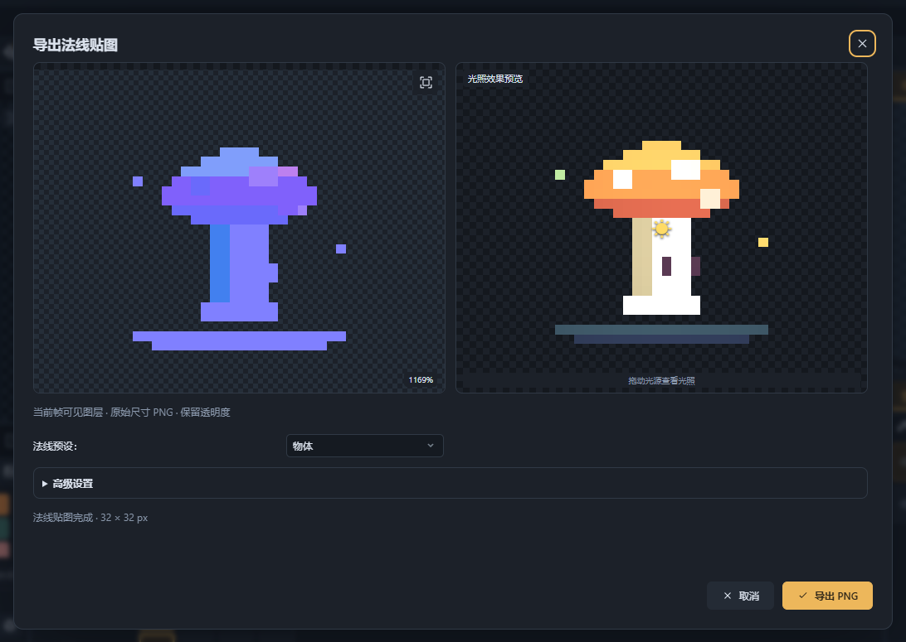
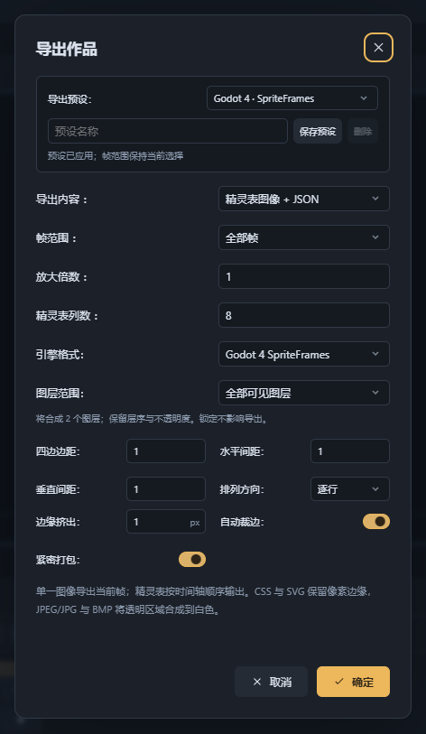

# 使用指南

从第一张像素画开始，再按需要使用动画、参考板、地形预览和游戏素材导出。快捷键以下述默认配置为准；可在“文件 → 设置”的快捷键配置中修改，或按 `F1` 查看当前快捷键。

本指南截图采集自 alpha.4 桌面版，使用中文界面，以深色主题为主；地形预览使用浅色主题和最大化窗口。面板可按自己的需要重新排列。

## 安装与启动

在本仓库 Releases 的对应版本中下载 `MinePix_<版本>_x64-setup.exe`。当前正式版为 2.0.1，支持 Windows x64；`.sig` 是更新器使用的签名文件，无需手动打开。选择英语、简体中文或繁体中文后，以当前用户安装。系统需要 WebView2 Runtime，缺失时按安装器提示完成安装。通过开始菜单或桌面入口启动。

安装界面的语言选项与编辑器语言分开；编辑器支持中文和英语。重要作品建议另存副本。

## 画第一张像素画

1. 通过“文件 → 新建”或 `Ctrl+N` 创建画布，例如 32 × 32。
2. 按 `B` 使用铅笔，在颜色面板选择前景色并绘画。`E` 切换橡皮，`G` 填充，`I` 吸管；按住 `Alt` 可临时取色。
3. 按住空格拖动以平移，滚轮缩放，`F` 适应画布，`1` 查看实际大小。
4. 按 `Ctrl+S` 保存为 `.pix`。`Ctrl+Z` 撤销，`Ctrl+Shift+Z` 或 `Ctrl+Y` 重做。
5. 通过“文件 → 导出 → 单一图像”选择 PNG 等输出格式。

可以先打开[蘑菇示例](../examples/mushroom.pix)体验编辑。保存 PIX 保留可编辑信息，导出图像用于分享和交付。

*中央画布用于编辑，右上预览便于观察整体效果；底部时间轴显示两层、四帧及“待机”标签。*

## 选区、图层与色板

按 `M` 激活选区工具，再次点击已激活的组合工具可选择矩形、椭圆、套索、多边形或魔棒。选中像素后，按 `Ctrl+T` 缩放或旋转；存在可编辑的可见选区时，`Ctrl+B` 可建立图案笔刷。

图层面板用于管理可见性、锁定、透明度和分组；`Ctrl+Shift+N` 新建像素图层。把角色、背景或效果放在不同图层，便于分别调整。

通过“颜色 → 颜色模式与量化”切换 RGBA、索引色或灰度。索引色使用实际色板索引：改变前景色与修改色板是不同操作，只有开启色板编辑并选中色槽时才修改色板。排序、删除或新增色槽后，可使用“重映射”恢复最接近的原色。转换模式影响全部帧和像素图层，参考图保持原色。

## 制作逐帧动画

1. 在时间轴选择当前帧，按 `Shift+N` 新建空白帧，或按 `Shift+D` 复制帧。
2. 绘制动作，设置各帧时长；通过“视图 → 画布显示 → 洋葱皮”对照相邻帧。
3. 通过“动画 → 标签”把帧范围命名为待机、行走等动作，并配置播放方向。
4. 通过“动画 → 播放”预览，再导出 GIF、WebP、PNG 序列或精灵表。

cel 指某帧中某图层的图像单元。时间轴可对 cel 范围进行复制、移动、变换和链接。链接 cel 共享内容，修改会影响使用同一内容的帧；需要单独编辑时先通过“动画 → cel范围 → 取消链接”解除共享。

## 把参考图带进工作区

通过“视图 → 面板 → 参考”显示参考板，在面板中导入图片，也可将图片拖入参考板。拖动图片调整位置，拖动四角等比缩放，通过右键菜单调整层次或重置位置，并可从参考图取色。

参考图随 PIX 保存，适合把角色设定、配色和材质样张留在作品旁。它们不参与画布合成及导出；删除参考图不会删除作品像素。参考板修改也需要保存项目。

*左侧参考板中的图片独立于画布图层。打开[参考板示例](../examples/reference-board.pix)，即可尝试移动、缩放和取色。*

## 检查图块与地形连接

此工作流用于检查图块规则与接缝，尤其适合绘制地形素材时反复验证边角。

1. 选择放有图块素材的像素图层，使用图层面板的“转为图集”按钮，设置图块宽高及切块帧。转换保留原图块的网格位置，全透明位置记为空格，并将所选帧的图集写回该图层所有帧；先保存副本再尝试。
2. 图集与地形预览只在当前项目存在图集图层时可添加或显示；无图集时右键添加入口不出现、视图菜单项禁用，删除最后一个图集图层或切换到无图集项目会隐藏这两个栏目。图集面板会随转换打开；通过“视图 → 面板”还可显示“地形预览”。在图集中选择图集图层，后续调整图块尺寸时点击“重新切块”使其生效。
3. 在地形集中添加地形，在“设置”模式下点击图块九宫格中心设置自身地形，点击四边或四角设置期望邻居地形，右键清除标注。
4. 已设置自身地形的图块可使用“自动标注”，按像素推断邻居规则，再人工检查结果。
5. 在地形预览中绘制地形，观察连接效果；有问题时回到图集修正规则或作品像素。

地形预览不会进入画布合成、普通图像导出或撤销历史。它不是完整关卡编辑器；Godot 的 SpriteFrames 导出也不等同于 TileSet 资源导出。预览输出最多 8M 像素、单边 8192，超限时按面板提示缩小预览。

*此处为[泥土匹配角示例](../examples/dirt-corners.pix)：从 dirt.ase 导入 128×128 素材，按 32×32 保留 4×4 排列，其中 15 块有像素、1 块透明。设置非空图块自身地形为“泥土”，选择“匹配角”后执行“自动标注”，左侧绘制的 50 格预览全部匹配。中央显示原图集，右侧可选择图块检查四角规则。*

## 生成法线贴图

通过“文件 → 导出 → 法线贴图”进入。输入为当前帧可见图层，输出为原始尺寸、保留透明度的 PNG。

先选择物体、角色、建筑或地形预设，查看法线与光照预览，再按需要调整形状强度、平滑、切面等高级设置。可自动估计原绘光照，或关闭自动估计后手动调整角度；需要 DirectX 方向时勾选“翻转 Y”。等待生成完成后选择“导出 PNG”。

这项功能根据二维图像估算法线，使用预览判断是否适合素材，不应将结果视为精确的三维几何信息。

*左侧检查法线分布，右侧拖动光源观察效果；图中使用“物体”预设。*

## 导出游戏素材

通过“文件 → 导出 → 精灵表 / 引擎图集”选择导出预设。可调整裁边、打包、边距、间隔及边缘扩展，并保存自定义预设供后续使用。

*图中选择 Godot 4 SpriteFrames，边缘扩展为 1 px，并启用自动裁边和紧密打包。切换预设可使用 Phaser 3 导出方案。*

| 用途 | 导出选择与内容 |
| --- | --- |
| 通用精灵表 | 图像及原生 JSON 元数据 |
| Phaser 3 | 图集图像、图集 `.json`、`.animations.json` 及补充 `.pixpix.json` 元数据 |
| Godot 4 | 图集图像、SpriteFrames `.tres` 及补充 `.pixpix.json` 元数据 |
| 动画预览 | 在“GIF动画”入口的导出对话框中选择 GIF 或 WebP |
| 逐帧交付 | PNG 序列 |

引擎预设使用作品的帧时长与动画标签生成动画信息。将导出文件一起交付，保持相对路径；在引擎中检查纹理过滤、资源路径及播放效果。

## 选择保存与交换格式

| 格式 | 适合用途 | 注意事项 |
| --- | --- | --- |
| PIX | 继续编辑的主项目 | 二进制分块压缩，保存图层、帧、色板、参考图及作品元数据，不能当作文本 JSON 编辑 |
| ASE / Aseprite | 与其他编辑器交换 | 通过“文件 → 导入 / 导出”使用，阅读导入限制提示；仍保留 PIX 主项目 |
| PNG、GIF、WebP 等 | 分享、预览或交付素材 | 导出结果不保留完整的编辑信息 |
| 精灵表及引擎资源 | 游戏开发交付 | 图像与配套元数据一起使用 |

通过“文件 → 导入”还可使用 PNG 序列、序列清单和精灵表 JSON。不要通过修改扩展名进行格式转换。

## 工作区与恢复

拖动面板标签调整布局，也可使用独立窗口组织工作区。面板隐藏时从“视图 → 面板”重新打开；布局混乱时选择“视图 → 布局 → 恢复默认布局”。

通过“文件 → 保存 → 恢复项目”检查可用恢复记录。恢复内容位于应用自己的数据目录；关闭、放弃修改及保存操作遵循界面提示。恢复记录用于应对意外中断，重要作品仍需单独备份。

## 更新

1. 首次使用默认选中“启动时自动检查更新”，启动后发现新版本会自动下载。可在“帮助 → 关于”关闭，已有选择会保留；也可通过“帮助 → 检查更新”手动检查。
2. 下载时可查看进度、取消或重试。安装包通过固定公钥签名与版本验证后保存在应用数据目录；未安装就关闭软件，下次启动会离线重新验证并直接复用，不重复下载。
3. 点击右下角“有可用更新，点击重启并更新”，或在更新面板选择“重启并更新”。按提示处理所有窗口中的未保存作品，再执行覆盖安装和自动重启；取消或安装失败会保留有效更新包。
4. 新版启动并确认更新已生效后，自动清除待安装包和元数据；安装器仍在退出的临时文件会在后台重试清理。不长期保留完整安装器副本，不删除用户自行保存的作品或下载的手动安装包。

下载完成的系统通知可返回正在运行的编辑器；退出应用后点击历史通知不保证能重新激活。也可从对应版本 Release 手动下载安装器。

安装器只注册可选的文件打开方式。需要修改默认关联时，请使用 Windows 的“打开方式”或默认应用设置。卸载应用不会删除用户保存的作品。

## 问题反馈

在仓库 Issues 描述应用版本、Windows / WebView2 版本、重现步骤及最小样例。不要在公开问题中包含私密作品、凭据或签名密钥。

开发与构建见[开发指南](DEVELOPMENT.md)，版本发布见[发布指南](RELEASING.md)，格式细节见[PIX 格式](PROJECT_FORMAT.md)。

同尺寸重新切块保留每个位置独立的地形、邻居位和权重，即使图块像素相同；改变尺寸后按内容迁移能够匹配的规则。检视器多选不同值时下拉留空，修改后统一应用到选中图块。

默认布局的下方栏目保持折叠，只显示标签条；点击时间轴标签或展开按钮后显示内容。手动折叠或展开状态保存在本机，重新启动及补回缺失栏目时保留，不随 PIX 文件单独切换。

PIX 项目使用长方形文档图标，软件使用独立的应用图标。首次安装只为尚未分配的 `.pix` 设置默认类型，保留用户已有的默认应用选择；覆盖安装刷新 MinePix 自身的文档图标及打开命令。
